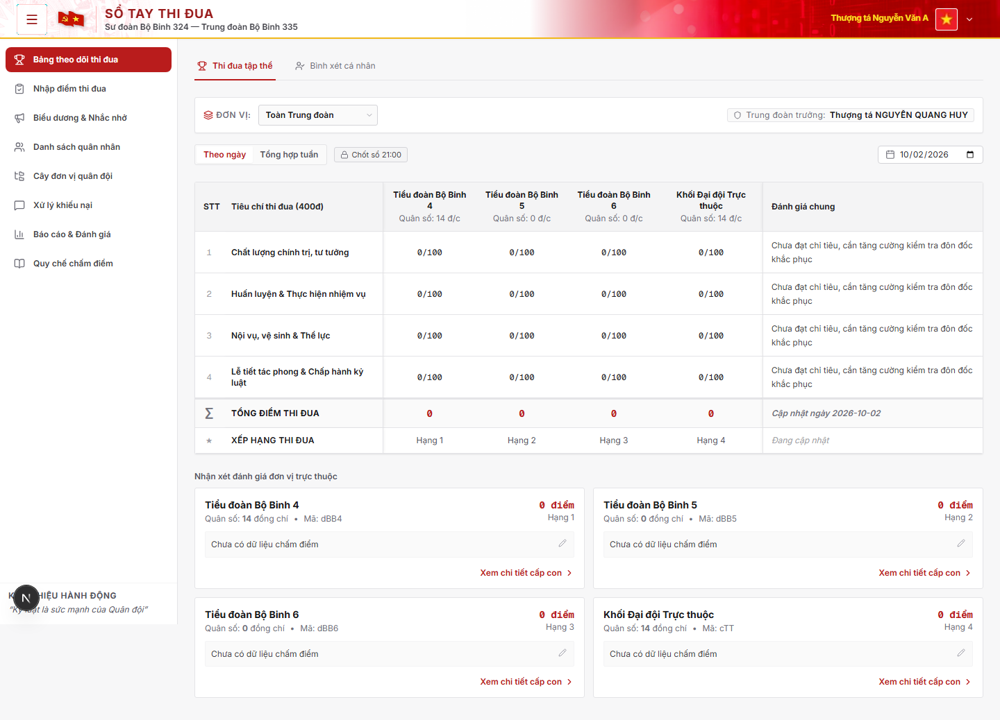
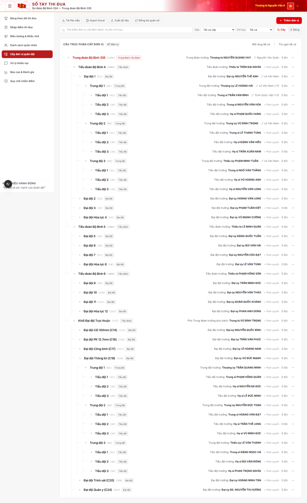
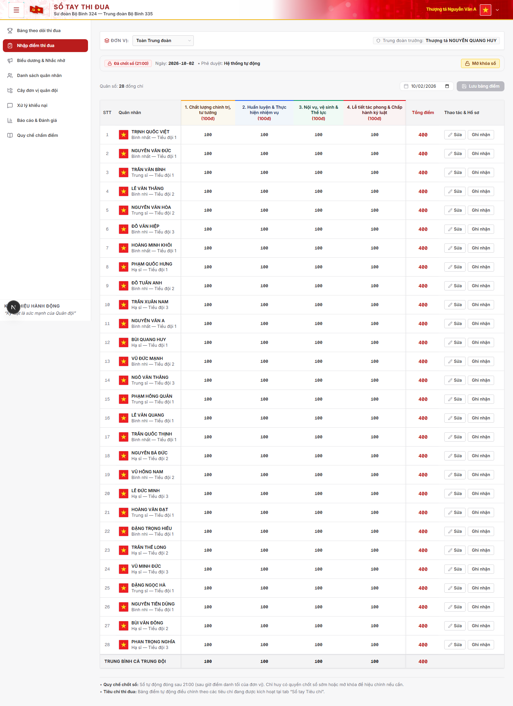
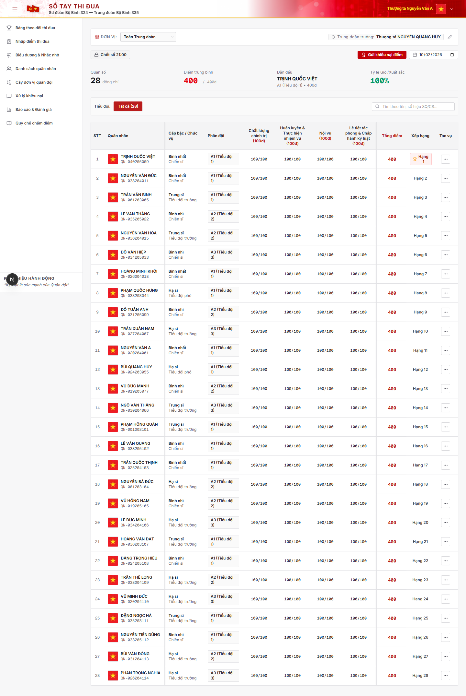
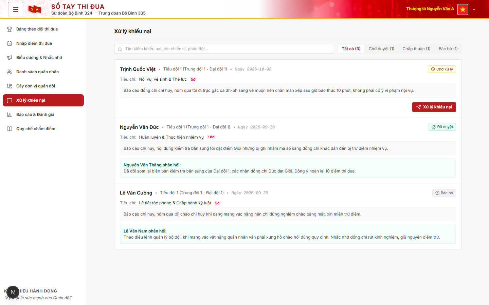
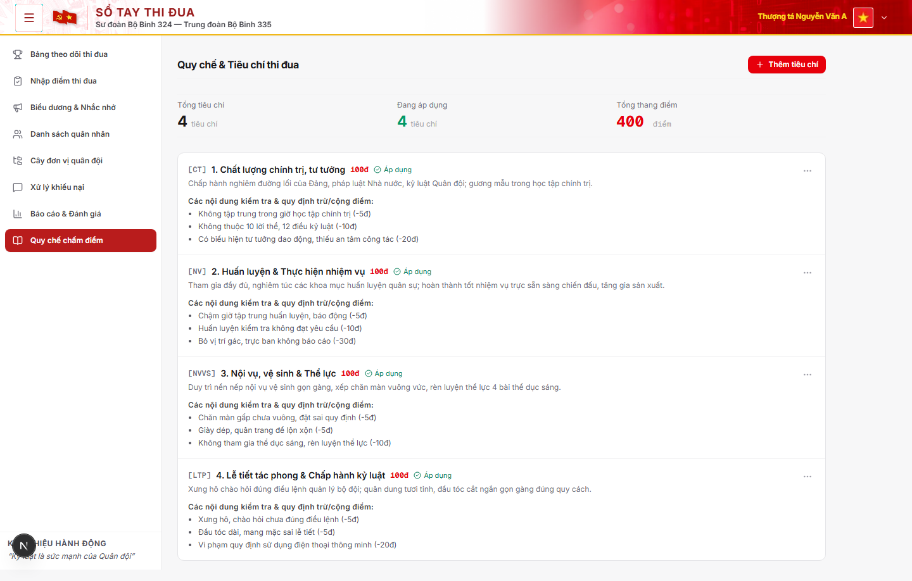
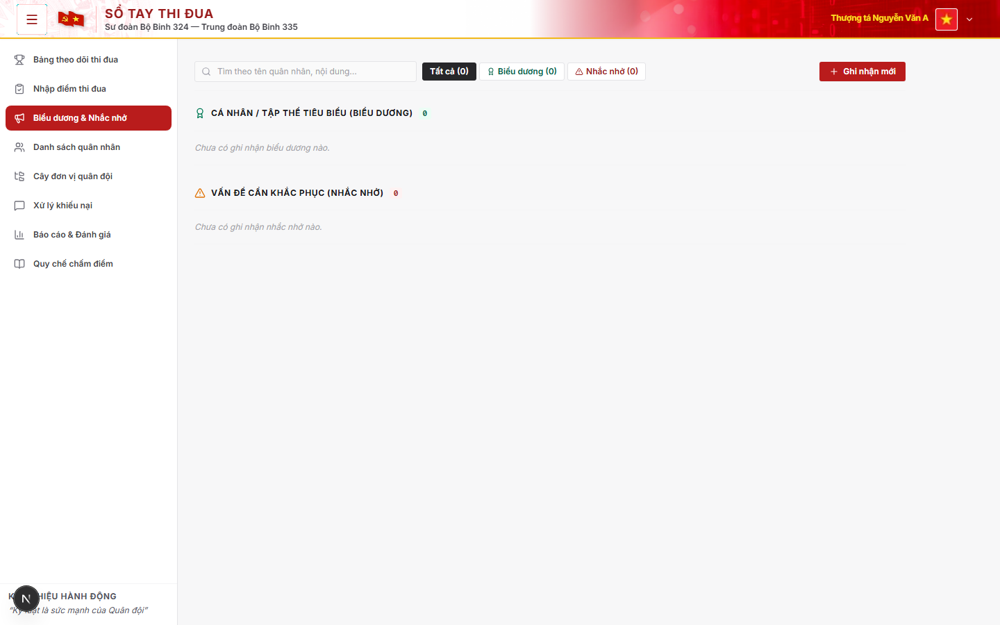
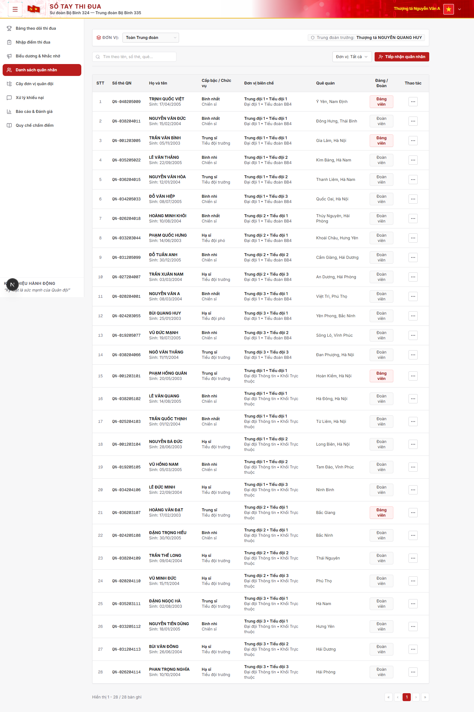

# Quản lý & Theo dõi Thi đua Quân nhân

> Hệ thống web quản lý nề nếp, chấm điểm thi đua hằng ngày, xếp loại định kỳ và xử lý khiếu nại điểm số tại Sư đoàn 324 - Trung đoàn 335.

[](https://nextjs.org/)
[](https://react.dev/)
[](https://spring.io/projects/spring-boot)
[](https://www.oracle.com/java/)
[](https://www.mysql.com/)
[](https://www.typescriptlang.org/)
[](https://tailwindcss.com/)
[](https://playwright.dev/)
[](https://www.docker.com/)

---

## Mục lục

- [Tính năng](#tính-năng)
- [Phân quyền](#phân-quyền)
- [Giao diện](#giao-diện)
- [Kiến trúc](#kiến-trúc)
- [Cài đặt & Khởi chạy](#cài-đặt--khởi-chạy)
  - [Cách 1: Docker Compose](#cách-1-docker-compose)
  - [Cách 2: Cài đặt thủ công](#cách-2-cài-đặt-thủ-công)
- [Biến môi trường](#biến-môi-trường)
- [Kiểm thử](#kiểm-thử)
- [Cấu trúc thư mục](#cấu-trúc-thư-mục)

---

## Tính năng

- **Cây đơn vị 5 cấp**: Phân cấp gồm Trung đoàn &rarr; Tiểu đoàn &rarr; Đại đội &rarr; Trung đội &rarr; Tiểu đội.
- **Phân quyền chấm điểm**: Gán quyền cho cán bộ phụ trách chấm điểm theo phân đội trên cây đơn vị.
- **Xử lý Race Condition & Khóa sổ điểm**:
  - Dùng Optimistic Locking với `@Version` trên `DailyScore` chống ghi đè khi 2 cán bộ cùng cập nhật điểm của một quân nhân.
  - Dùng Pessimistic Locking với `PESSIMISTIC_WRITE` trên `DailyLock` khi Chốt sổ điểm 21:00, đảm bảo 1 transaction khóa hoặc mở dữ liệu ngày.
- **Khiếu nại điểm**: Quân nhân gửi giải trình điểm trừ; cán bộ kiểm tra, phản hồi và duyệt hoàn điểm.

---

## Phân quyền

Hệ thống phân quyền theo 3 vai trò:

| Chức năng | ADMIN | SCORER | SOLDIER |
| :--- | :---: | :---: | :---: |
| **Cây đơn vị & Phân quyền cán bộ** | Toàn quyền | Bị chặn | Bị chặn |
| **Quy chế & Tiêu chí thi đua** | Quản trị tiêu chí | Xem danh mục | Xem danh mục |
| **Nhập điểm thi đua hằng ngày** | Toàn đơn vị | Phân đội được gán | Không có quyền |
| **Bảng tổng hợp thi đua phân đội** | Toàn đơn vị | Phân đội phụ trách | Không hiển thị |
| **Kết quả thi đua cá nhân** | Toàn đơn vị | Phân đội phụ trách | Xem của bản thân |
| **Xử lý khiếu nại thi đua** | Toàn đơn vị | Phân đội phụ trách | Gửi khiếu nại |
| **Biểu dương & Nhắc nhở** | Toàn đơn vị | Phân đội phụ trách | Xem bảng tin |
| **Báo cáo & Thống kê đánh giá** | Toàn đơn vị | Phân đội phụ trách | Không hiển thị |

Router Guard áp dụng 2 tầng: Client-side redirect tại `frontend/my-app/app/page.tsx` và Server-side Filter chặn HTTP 403 khi truy cập trái phép.

---

## Giao diện

### 1. Bảng theo dõi thi đua phân đội

- **Mục đích**: Theo dõi điểm thi đua, xu hướng và xếp hạng phân đội.
- **Thao tác**: Lọc theo ngày, tuần, tháng; xem tỷ lệ kỷ luật và điểm trung bình.

---

### 2. Cây đơn vị & Phân quyền cán bộ chấm điểm

- **Mục đích**: Quản lý cơ cấu đơn vị và phân quyền chấm điểm theo phân đội.
- **Thao tác**: Thêm hoặc sửa đơn vị, gán cán bộ chấm điểm cho đơn vị.

---

### 3. Sổ nhập điểm thi đua hằng ngày

- **Mục đích**: Nhập và lưu điểm thi đua hằng ngày theo tiêu chí.
- **Thao tác**: Chọn phân đội, chọn lỗi vi phạm hoặc điểm cộng, nhập ghi chú và lưu.

---

### 4. Kết quả thi đua quân nhân cá nhân

- **Mục đích**: Quân nhân tra cứu kết quả thi đua và lịch sử điểm số.
- **Thao tác**: Xem điểm tích lũy, chi tiết cộng trừ điểm và xếp loại.

---

### 5. Quản lý & Giải quyết khiếu nại thi đua

- **Mục đích**: Tiếp nhận và xử lý giải trình, khiếu nại điểm trừ.
- **Thao tác**: Quân nhân gửi khiếu nại; cán bộ duyệt hoàn điểm hoặc từ chối.

---

### 6. Quy chế & Cẩm nang tiêu chí chấm điểm

- **Mục đích**: Danh mục tiêu chuẩn đánh giá và thang điểm.
- **Thao tác**: Tra cứu tiêu chí; thêm hoặc sửa mức điểm.

---

### 7. Biểu dương & Nhắc nhở kỷ luật

- **Mục đích**: Bảng tin biểu dương tập thể, cá nhân và thông báo nhắc nhở.
- **Thao tác**: Đăng tin biểu dương hoặc nhắc nhở kèm nội dung và đơn vị.

---

### 8. Danh sách & Hồ sơ quân nhân

- **Mục đích**: Quản lý thông tin hồ sơ và biên chế quân nhân.
- **Thao tác**: Tìm kiếm, lọc theo cấp bậc, chức vụ, đơn vị; xem lý lịch.

---

## Kiến trúc

```
                     NGINX GATEWAY / REVERSE PROXY
                      SSL/TLS, Gzip, Rate Limiting
                                     │
           ┌─────────────────────────┴─────────────────────────┐
           │ Port 3005                                         │ Port 8080
           ▼                                                   ▼
┌────────────────────────────┐                     ┌────────────────────────────┐
│      FRONTEND SERVICE      │                     │      BACKEND SERVICE       │
│  - Next.js 16 App Router   │  RESTful API calls  │  - Spring Boot 3.3.4       │
│  - React 19 / TypeScript   │ ──────────────────> │  - Java 21 LTS             │
│  - Tailwind CSS v4         │   Bearer JWT Auth   │  - Spring Security + JWT   │
│  - Zustand State Store     │                     │  - JPA / Hibernate 6       │
│  - Recharts / Lucide UI    │                     │  - Optimistic Locking      │
└────────────────────────────┘                     └─────────────┬──────────────┘
                                                                 │ JDBC :3306
                                                                 ▼
                                                   ┌────────────────────────────┐
                                                   │      DATABASE SERVICE      │
                                                   │  - MySQL 8.0               │
                                                   │  - Sư đoàn 324 Schema      │
                                                   │  - Persistent Docker Vol   │
                                                   └────────────────────────────┘
```

### Công nghệ

- **Frontend**: Next.js 16 App Router, React 19, TypeScript, Tailwind CSS v4, Zustand, Recharts, Lucide Icons.
- **Backend**: Spring Boot 3.3.4, Java 21 LTS, Spring Security, Spring Data JPA, Hibernate, JWT, Maven.
- **Cơ sở dữ liệu**: MySQL 8.0.
- **Kiểm thử**: Playwright Test E2E, JUnit 5, Mockito, JaCoCo.
- **Hạ tầng**: Docker, Docker Compose, Nginx.

---

## Cài đặt & Khởi chạy

### Yêu cầu

- Docker & Docker Compose
- Node.js v20+ và pnpm v10+ khi chạy frontend thủ công
- JDK 21 & Maven 3.9+ khi chạy backend thủ công
- MySQL 8.0+ khi chạy cơ sở dữ liệu cục bộ

---

### Cách 1: Docker Compose

Khởi động MySQL, Backend và Frontend:

1. **Chuẩn bị file môi trường**:
   ```bash
   cp .env.example .env
   ```

2. **Khởi chạy hệ thống**:
   ```bash
   docker compose -f docker-compose.local.yml up -d --build
   ```

3. **Kiểm tra trạng thái container**:
   ```bash
   docker compose -f docker-compose.local.yml ps
   ```

4. **Địa chỉ truy cập**:
   - Giao diện web: [http://localhost:3005](http://localhost:3005)
   - API Backend: [http://localhost:8080/api/v1](http://localhost:8080/api/v1)
   - MySQL Database: `localhost:3306`

---

### Cách 2: Cài đặt thủ công

#### 1. Khởi động MySQL Database
Chạy container MySQL:
```bash
docker compose -f docker-compose.local.yml up -d mysql
```
Nếu cài MySQL trên máy, import file dữ liệu mẫu:
```bash
mysql -u root -p sudoan324 < database/seed_sudoan324.sql
```

#### 2. Khởi động Backend
```bash
cd backend
./mvnw spring-boot:run
# Windows PowerShell:
# .\mvnw.cmd spring-boot:run
```
Backend chạy tại: `http://localhost:8080`.

#### 3. Khởi động Frontend
Mở terminal riêng:
```bash
cd frontend/my-app
pnpm install
pnpm dev
```
Truy cập Frontend tại: `http://localhost:3005`.

---

## Biến môi trường

| Biến môi trường | Giá trị mặc định | Giải thích |
| :--- | :--- | :--- |
| `DB_NAME` | `sudoan324` | Tên database MySQL |
| `DB_USER` | `root` | Username kết nối database |
| `DB_PASSWORD` | `change_me_db_password` | Password kết nối database |
| `DB_ROOT_PASSWORD` | `change_me_root_password` | Password tài khoản root của MySQL |
| `JWT_SECRET` | chuỗi 256-bit | Khóa ký và giải mã JWT token |
| `MAIL_HOST` | `smtp.gmail.com` | SMTP host gửi thông báo |
| `MAIL_PORT` | `587` | Port kết nối SMTP TLS |
| `MAIL_USERNAME` | `your_email@gmail.com` | Email gửi thông báo |
| `MAIL_PASSWORD` | Mật khẩu ứng dụng Gmail | Password ứng dụng của Gmail |
| `NEXT_PUBLIC_API_BASE_URL` | `http://localhost:8080/api/v1` | URL gốc gọi API từ Frontend |

---

## Kiểm thử

### 1. E2E Playwright
```bash
cd frontend/my-app

# Chạy test E2E headless
npx playwright test

# Chạy test với UI Mode
npx playwright test --ui

# Xem báo cáo HTML
npx playwright show-report
```

### 2. Backend JUnit
```bash
cd backend
./mvnw clean test
```

### 3. Lint & Build
```bash
cd frontend/my-app
pnpm lint
pnpm build
```

---

## Cấu trúc thư mục

```text
.
├── backend/                 # API Spring Boot 3 Java 21, Spring Security & JPA
├── frontend/my-app/         # Giao diện Next.js 16 React 19, Tailwind CSS v4
├── database/                # Schema & script seed data MySQL Sư đoàn 324
├── docs/                    # Tài liệu kỹ thuật & screenshots
├── docker-compose.local.yml # Khởi chạy môi trường local fullstack
└── .env.example             # File cấu hình mẫu biến môi trường
```
